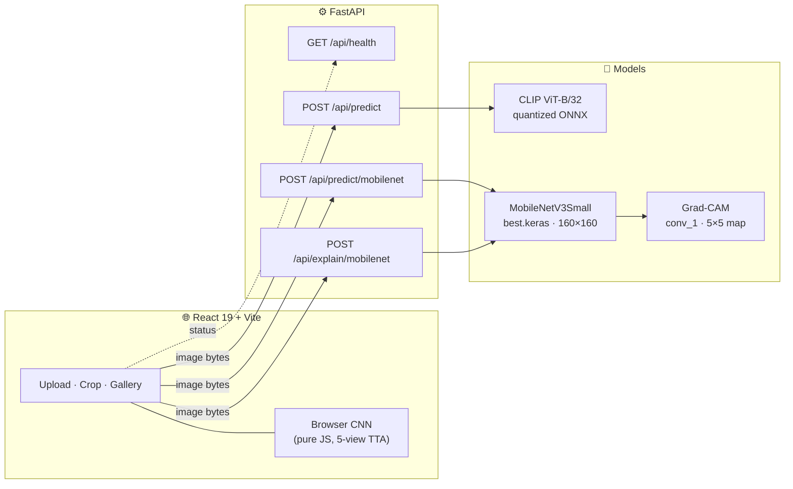

<div align="center">

# 👗 FashionVision

### Three ways to see fashion — one trained CNN, one zero-shot transformer, one network running entirely in your browser.

*A full-stack computer-vision system for fashion image classification, with Grad-CAM explainability, a FastAPI backend and a React interface.*

<br>


[Overview](#-overview) · [Architecture](#-architecture) · [Models](#-the-three-inference-engines) · [Quick start](#-quick-start) · [API](#-api-reference) · [Research pipeline](#-research-pipeline) · [Limitations](#-limitations--honest-notes)

</div>

---

## ✨ Overview

**FashionVision** classifies clothing and accessory images and shows *why* a model made its decision. Upload a product photo, optionally crop to the item, and get class probabilities plus a **Grad-CAM heatmap** highlighting the regions that drove the prediction.

The project deliberately ships **three independent inference paths**, each suited to a different data distribution, instead of forcing one model to do everything:

| | Engine | Input domain | Classes | Runs where |
|---|---|---|---|---|
| 🎯 | **MobileNetV3Small** (trained) | RGB product photos | 10 product classes | Server (TensorFlow/Keras) |
| 🧠 | **CLIP ViT-B/32** (zero-shot) | RGB real-world photos | 10 Fashion-MNIST classes | Server (quantized ONNX) |
| ⚡ | **Browser CNN** | 28×28 grayscale Fashion-MNIST | 10 Fashion-MNIST classes | Client (pure JavaScript) |

### Highlights

- **99.25 % accuracy / 99.92 % top-3** on a saved 2,546-image held-out split, with a **family-aware split** designed to reduce near-duplicate leakage between train and test.
- **Grad-CAM explanations** computed from the deployed graph and cross-checked against inference output; the endpoint refuses to answer if they disagree.
- **Zero-shot CLIP path** with a hand-written, dependency-free BPE tokenizer and a versioned prompt ensemble.
- **A CNN implemented in plain JavaScript** (convolution, batch-norm, pooling, dense layers) with five-view shift test-time augmentation — no ML framework shipped to the browser.
- **Integrity-first serving:** model and config SHA-256 hashes are verified before loading; uploads are bounded by bytes, dimensions and pixel count.
- **Honest evaluation:** every score is labelled *uncalibrated*, and known limitations are documented rather than hidden.

---

## 🏗 Architecture



**Request flow.** The browser sends raw image bytes with the matching `Content-Type`. FastAPI validates type and size, then hands decoding and inference to a thread pool so the event loop stays responsive. TensorFlow is imported lazily — a CLIP-only deployment never loads it.

---

## 🧬 The Three Inference Engines

### 🎯 1 · MobileNetV3Small — trained product classifier

Transfer learning from official ImageNet weights, trained fresh (no previous checkpoint was ever loaded).

| Property | Value |
|---|---|
| Backbone | MobileNetV3Small, ImageNet-initialised |
| Input | 160 × 160 RGB, float32 in [0, 255] (normalisation built into the model) |
| Parameters | 944,890 |
| Checkpoint | `models/mobilenet-family-v1/best.keras` — 10.26 MB |
| Run ID | `mobilenet_family_v1_77a4872e94084b1fbda881dab6316972` |
| Classes | T-shirts · Shirts · Kurtas · Pants · Closed shoes · Handbags · Watches · Sunglasses · Backpacks · Belts |
| Data split | 20,364 train · 2,545 validation · 2,546 test |
| Source dataset | Fashion Product Images (Small), per recorded provenance |

**Two-stage training recipe**

| Stage | Backbone | Learning rate | Max epochs | Notes |
|---|---|---|---|---|
| 1 | Frozen | 1e-3 | 5 | Train the new classification head |
| 2 | Unfrozen from `expanded_conv_8_expand`, BatchNorm kept frozen | 1e-4 | 8 | Fine-tune upper blocks |

Adam · sparse categorical cross-entropy · batch size 32 · seed 42 · deterministic ops · early stopping on `val_accuracy` (patience 2) · inverse-frequency class weights `N_train / (10 · class_count)` · augmentation: horizontal flip, ±3 % rotation, 10 % zoom, 0.1 contrast (reflect fill). Best checkpoint selected at **global epoch 12** by validation accuracy. Total training time ≈ **26 minutes on CPU**.

**Saved held-out results (2,546 images)**

| Metric | Score |
|---|---|
| Accuracy | **0.9925** |
| Top-3 accuracy | **0.9992** |
| Macro precision / recall / F1 | 0.9920 / 0.9931 / **0.9925** |
| Weighted F1 | 0.9925 |

<details>
<summary><b>Per-class breakdown</b></summary>

| Class | Precision | Recall | F1 | Support |
|---|---:|---:|---:|---:|
| T-shirts | 0.991 | 0.991 | 0.991 | 687 |
| Shirts | 0.986 | 0.980 | 0.983 | 293 |
| Kurtas | 0.984 | 0.984 | 0.984 | 184 |
| Pants | 1.000 | 1.000 | 1.000 | 142 |
| Closed shoes | 1.000 | 0.996 | 0.998 | 551 |
| Handbags | 0.972 | 0.994 | 0.983 | 176 |
| Watches | 1.000 | 1.000 | 1.000 | 254 |
| Sunglasses | 1.000 | 1.000 | 1.000 | 106 |
| Backpacks | 0.986 | 0.986 | 0.986 | 72 |
| Belts | 1.000 | 1.000 | 1.000 | 81 |

The few remaining errors concentrate in visually adjacent classes: T-shirts ↔ Shirts ↔ Kurtas, and Handbags ↔ Backpacks.

</details>

**Throughput (batched, CPU):** ≈ 5.2 ms/image model compute and ≈ 14.9 ms/image end-to-end at batch size 32. Single-request latency was **not measured**, so batched throughput should not be read as per-request latency.

#### 🔥 Grad-CAM explainability

`POST /api/explain/mobilenet` returns the prediction together with a red heatmap overlay.

1. Differentiate the **pre-softmax logit** of the predicted class with respect to the backbone's `conv_1` activations.
2. Average gradients spatially to get per-channel weights.
3. Weighted sum of activations → **ReLU** → per-image max normalisation → a **5 × 5** map.
4. Bilinearly upsample onto the 160 × 160 model-input view and return a base64 PNG.

Safeguards: the explanation graph must **reproduce the inference probabilities** (otherwise 503), and a map with no positive attribution is returned uncoloured with status `NO_POSITIVE_ATTRIBUTION`. Grad-CAM here is coarse class attribution — not segmentation and not causal proof.

### 🧠 2 · CLIP ViT-B/32 — zero-shot photo classifier

Real-world photos look nothing like 28×28 grayscale Fashion-MNIST thumbnails, so uploads can be routed to a zero-shot model that needs no training on this task.

- **Model:** quantized combined CLIP ViT-B/32 ONNX export ([`Xenova/clip-vit-base-patch32`](https://huggingface.co/Xenova/clip-vit-base-patch32), MIT licence), ≈ 146 MB, downloaded separately and **SHA-256 verified**.
- **Prompt ensemble:** 23 hand-written natural-language prompts mapped onto the ten Fashion-MNIST classes (T-shirt/top, Trouser, Pullover, Dress, Coat, Sandal, Shirt, Sneaker, Bag, Ankle boot). Prompts are versioned in `ml/photo_classifier.py` and encode distinctions that matter — e.g. a quarter-zip fleece is a *Pullover*, while a *Shirt* means button-front garments.
- **Tokenizer:** a small dependency-free implementation of CLIP's byte-level BPE tokenizer, using the bundled `vocab.json` and `merges.txt`.
- **Runtime:** ONNX Runtime — no PyTorch or TensorFlow required.

### ⚡ 3 · Browser CNN — inference without a server

A compact Fashion-MNIST CNN re-implemented in **plain JavaScript** (`frontend/react/public/frontend/cnn-browser.js`, ~190 lines).

```text
Input 28×28×1 → Conv 3×3 (32, ReLU) → BatchNorm → MaxPool 2×2
              → Conv 3×3 (64, ReLU) → BatchNorm → MaxPool 2×2
              → Flatten → Dense 128 (ReLU) → Dense 10 (softmax)
```

- Weights ship as base64-encoded float32 in `model_weights.json` (≈ 2.2 MB).
- **Five-view shift-only test-time augmentation** averages predictions across small shifts for a steadier result.
- Powers the **40-image test gallery** in the UI — weights load once, then every prediction runs locally with no server round-trip.
- A standalone Node reference implementation (`tests/browser/inference.js`) is used to cross-check behaviour.

---

## 🚀 Quick Start

**Prerequisites:** Python 3.12 (the version recorded with the shipped model), Node.js 20.19+ (required by Vite 7) and npm.

```bash
# 1 · Clone
git clone https://github.com/hassankadri/FashionVision.git
cd FashionVision

# 2 · Python environment
python -m venv .venv
source .venv/bin/activate            # Windows: .venv\Scripts\activate
python -m pip install -r requirements-mobilenet.txt

# 3 · Download the CLIP ONNX model (~146 MB, checksum-verified)
python scripts/download_photo_model.py

# 4 · Build the React frontend
npm ci --prefix frontend/react
npm run build --prefix frontend/react

# 5 · Launch
python -m uvicorn backend.app:app --host 0.0.0.0 --port 8765
```

Open **http://localhost:8765**. The API serves the production bundle at `/`, bundled assets at `/assets`, and shared browser-CNN resources at `/frontend`.

> **Shortcut:** `python app.py` starts the server on loopback only, using `FASHION_APP_PORT` (default `8765`).

### Frontend development (hot reload)

```bash
python -m uvicorn backend.app:app --port 8765     # terminal 1 — API
npm run dev --prefix frontend/react               # terminal 2 — Vite dev server
```

Vite proxies API calls to port 8765 and serves the CNN resources from its own public directory.

### Production frontend routing (Vercel)

The frontend's Vercel project should use Root Directory `frontend/react`,
Framework Preset **Vite**, Build Command `npm run build`, and Output Directory
`dist`. Keep existing compatible build settings. Small-image rewrites need no
new environment variables; private uploads require server-only configuration
and the Vercel Blob SDK described below.

[`frontend/react/vercel.json`](frontend/react/vercel.json) configures two
exact-path external rewrites:

| Same-origin frontend request | CLIP backend destination |
|---|---|
| `/api/predict` | `https://fashion-vision-clip.vercel.app/api/predict` |
| `/api/health` | `https://fashion-vision-clip.vercel.app/api/health` |

After the next frontend deployment, React continues requesting
`https://fashion-vision.vercel.app/api/...`. Vercel proxies these two paths to
CLIP without a browser redirect. The prediction request remains POST with raw
image bytes and the existing Content-Type; prediction fields, confidence
display, cropping and UI behavior are unchanged. The health indicator reports
CLIP availability, not MobileNet or Grad-CAM readiness.

There is no wildcard API rewrite: `/api/predict/mobilenet` and
`/api/explain/mobilenet` are not sent to CLIP. Their production routing requires
their own backend configuration. Local development remains unchanged:
`vite.config.js` proxies all `/api` requests to `http://127.0.0.1:8765`.

**Private uploads:** Files up to 4,000,000 bytes retain the existing raw request
path. Larger files, up to the original **15 MiB** limit, use direct
browser-to-private-Blob uploads when configured. Only a single-use receipt
reaches the backend through the new Node gateway; the image bytes bypass
Vercel's 4.5 MB function request limit. No compression or model changes are added.

OIDC-backed presigned uploads avoid a static Blob token; private backend reads
and deletion use runtime OIDC. Keep `PRIVATE_UPLOADS_ENABLED=0` or absent.
Activation requires shared free Redis state, server-only security settings,
working daily cleanup and verified deployed backend changes. See [private upload setup, security and retention](docs/PRIVATE_UPLOADS.md).
Local Vite behavior remains unchanged; no production settings are enabled here.

See [Vercel external rewrites](https://vercel.com/docs/routing/rewrites) and
[function limits](https://vercel.com/docs/functions/limitations).

### Lighter installs

| Goal | Command |
|---|---|
| CLIP-only (no TensorFlow) | `pip install -r requirements.txt` |
| Full app: CLIP + MobileNet + Grad-CAM | `pip install -r requirements-mobilenet.txt` |
| Research / training | `pip install -r requirements-training.txt` |
| Run the tests | `pip install -r requirements-test.txt` |

---

## 📡 API Reference

Interactive OpenAPI docs are available at `/docs` while the server is running. All prediction endpoints accept **raw image bytes** (not multipart) with a matching `Content-Type` of `image/jpeg`, `image/png`, `image/webp` or `image/bmp`.

| Method | Endpoint | Purpose |
|---|---|---|
| `GET` | `/api/health` | Reports whether the CLIP model file is present |
| `POST` | `/api/predict` | CLIP zero-shot photo classification |
| `POST` | `/api/predict/mobilenet` | Trained MobileNet classification |
| `POST` | `/api/explain/mobilenet` | MobileNet prediction + Grad-CAM overlay |

### Examples

```bash
# Classify with the trained MobileNet
curl -X POST http://localhost:8765/api/predict/mobilenet \
     -H "Content-Type: image/jpeg" \
     --data-binary @photo.jpg

# Prediction + Grad-CAM overlay
curl -X POST http://localhost:8765/api/explain/mobilenet \
     -H "Content-Type: image/jpeg" \
     --data-binary @photo.jpg

# CLIP zero-shot
curl -X POST http://localhost:8765/api/predict \
     -H "Content-Type: image/png" \
     --data-binary @photo.png
```

### `POST /api/predict/mobilenet` — response

```jsonc
{
  "prediction": "Shirts",
  "probabilities": [ { "class_id": 0, "label": "T-shirts", "probability": 0.01 }, /* … 10 entries, class order */ ],
  "top3": [ { "class_id": 1, "label": "Shirts", "probability": 0.97 }, /* … */ ],
  "model": "mobilenetv3small-family-v1-77a4872e94084b1fbda881dab6316972",
  "inference_time_ms": 12.3,
  "score_type": "uncalibrated_softmax"
}
```

`inference_time_ms` covers the model call only — it excludes loading, preprocessing, lock wait and network time.

### `POST /api/explain/mobilenet` — response fields

`prediction`, `explained_class`, `model`, `target_layer` (`conv_1`), `target_score` (`pre_softmax_logit`), `attribution_status`, `overlay_size`, `overlay_format` and `heatmap_overlay_base64` (plain base64 PNG).

### Limits & error codes

| Limit | Value |
|---|---|
| Max upload size | 15 MiB |
| Max side length | 8,192 px |
| Max pixels | 16,000,000 |
| Multi-frame / animated images | Rejected |

| Status | Meaning |
|---|---|
| `400` | Empty, corrupt, mismatched-format or oversized-dimension image |
| `413` | Upload exceeds 15 MiB |
| `415` | Unsupported `Content-Type` |
| `503` | Model assets or dependencies unavailable (details logged server-side only) |

**MobileNet preprocessing:** EXIF orientation applied → transparency composited on white → converted to RGB → resized to 160×160 with Pillow bilinear interpolation → float32 pixels in [0, 255].

> ⚠️ MobileNet class order differs from the CLIP / Fashion-MNIST vocabulary — the two endpoints return different label sets.

Full details: [`docs/MOBILENET_API.md`](docs/MOBILENET_API.md).

---

## 🔬 Research Pipeline

The `scripts/` directory documents the project's evolution, from a classical baseline on Fashion-MNIST to a family-aware RGB benchmark.

### Fashion-MNIST track (numbered, run in order)

| Step | Script | What it does |
|---:|---|---|
| 0 | `0_load_dataset.py` | Decode the original IDX-ubyte files into NumPy arrays |
| 1 | `1_explore_and_clean.py` | Check for duplicates, constant/blank images and missing data |
| 2 | `2_train_classical_baseline.py` | PCA (95 % variance) + classical models |
| 3 | `3_train_cnn.py` | CNN with data augmentation |
| 4 | `4_detect_label_issues.py` | Confident-learning label-error detection with **cleanlab** |
| 5 | `5_compare_models.py` | Classical vs CNN on the same held-out test set |
| 6 | `6_optimize_classical.py` | Retrain on the full set after removing 4,710 flagged labels |
| 7 | `7_optimize_cnn.py` | Cleaned labels + horizontal-flip augmentation + `ReduceLROnPlateau` |

### RGB product-image track

| Script | Role |
|---|---|
| `prepare_fashion_products_v1.py` | Audit original product files and build immutable reference manifests — no training, rewriting or deletion |
| `prepare_fashion_families_v1.py` | Input-only inferred **family grouping** so near-identical product shots stay in the same split |
| `mobilenet_fashion_v1.py` | Two-stage MobileNetV3 baseline on the original manifests |
| `mobilenet_family_v1.py` | The shipped model: one fresh ImageNet run on the frozen family benchmark |
| `label_quality_v1.py` | Label-quality experiment — flags are *suspicions, never corrections* |
| `classical_v3.py` | Classical experiment with fold-local PCA and train-only selection |
| `real_photo_evaluation_v1.py` | Independent, manually labelled photo evaluation (never trains or saves) |
| `evaluate_saved_fashion_references.py` | Subset metrics from saved predictions — no inference re-run |
| `download_photo_model.py` | Fetch and checksum-verify the CLIP ONNX model |

### Supporting packages

- **`fashion_rgb_data/`** — a read-only RGB dataset pipeline: layout audit, class mapping, exact-byte and decoded-pixel duplicate detection, cross-split leakage checks, reproducible per-sample augmentation. Original files are never modified.
  ```bash
  python -B -m fashion_rgb_data <dataset-dir> [--mapping mapping.json]
  ```
- **`fashion_evaluation/`** — metrics and report generation (accuracy, per-class precision/recall/F1, confusion matrices).

---

## 🗂 Project Structure

```text
FashionVision/
├── app.py                         # Local launcher (loopback, FASHION_APP_PORT)
├── backend/
│   └── app.py                     # FastAPI routes + React static serving
├── ml/
│   ├── mobilenet_classifier.py    # Hash-verified, lazily loaded, thread-safe inference
│   ├── mobilenet_gradcam.py       # Class-specific Grad-CAM + overlay renderer
│   └── photo_classifier.py        # CLIP ONNX zero-shot + BPE tokenizer + prompts
├── frontend/react/
│   ├── src/                       # React UI (upload, crop editor, results, gallery)
│   └── public/frontend/           # Browser CNN, weights, 40-image sample gallery
├── models/
│   ├── mobilenet-family-v1/       # best.keras, config, evaluation, provenance
│   └── clip-vit-base-patch32/     # Tokenizer files (ONNX downloaded separately)
├── scripts/                       # Dataset prep, training, evaluation
├── fashion_rgb_data/              # RGB dataset audit + loader
├── fashion_evaluation/            # Metrics and reporting
├── tests/                         # Python + Node regression tests, fixtures
├── docs/                          # API and dependency documentation
└── requirements*.txt              # Dependency groups
```

---

## 🛡 Engineering Notes

- **Verified model loading.** `best.keras` and `configuration.json` are checked against pinned SHA-256 hashes, class order and input/output shapes before the model is used.
- **Lazy, cached, serialised.** TensorFlow loads on first MobileNet request; a single cached model plus a lock serves prediction and explanation. Load failures are cached until restart rather than retried on every request.
- **Output validation.** Probabilities must be finite, in [0, 1] and sum to 1 — otherwise the request fails with a generic 503 and details go to the server log.
- **Bounded uploads.** Streamed byte limit, pre-decode dimension and pixel checks, MIME-versus-actual-format matching, and decompression-bomb handling.
- **Non-blocking I/O.** Decoding and inference run in a thread pool.
- **No data leaves the browser unnecessarily.** Cropping happens client-side; only the selected image is sent for inference.

---

## 🧪 Testing

```bash
python -B -m unittest discover -s tests -v      # Python regression suite
node tests/browser/inference.js                 # Browser CNN reference harness
node --test tests/test_browser_baseline.cjs     # Browser baseline checks
```

Coverage spans API contracts, MobileNet preprocessing, Grad-CAM, dataset preparation, metrics, label quality, and browser/Python parity snapshots.

> The full suite is **not fully self-contained**: CLIP tests need the ONNX download, some tests need external reference photos (`FASHION_TEST_IMAGE`), and historical smoke tests need original artifacts that are not bundled. Synthetic fixtures check mechanics and finite outputs — not natural-photo accuracy.

---

## ⚙️ Configuration

| Variable | Default | Purpose |
|---|---|---|
| `FASHION_APP_PORT` | `8765` | Port used by `python app.py` / `python -m backend.app` |
| `FASHION_TEST_IMAGE` | — | Path to an external reference photo for tests |

**Pinned environment recorded with the shipped model:** Python 3.12.3 · TensorFlow 2.21.0 · Keras 3.15.1 · NumPy 2.5.3 · Pillow 12.3.0. See [`docs/ENVIRONMENTS.md`](docs/ENVIRONMENTS.md) for all dependency groups.

---

## ⚠️ Limitations & Honest Notes

- **Scores are not calibrated confidence.** MobileNet softmax outputs and CLIP similarity scores should be read as rankings, not probabilities of being correct.
- **Benchmark ≠ natural-photo accuracy.** The 99.25 % figure is measured on product-catalogue imagery. Independent accuracy on arbitrary real-world photos has **not** been established.
- **Family grouping is inferred.** There are no authoritative product-family IDs; groups are derived from metadata and visual similarity, may over- or under-group, and weak cross-split candidates remain.
- **Single seed, single configuration.** No repeated tuning and no uncertainty estimates.
- **Grad-CAM is coarse.** A 5 × 5 map is an indication of attribution, not a segmentation.
- **Reproduction needs external inputs.** Datasets, raw Fashion-MNIST IDX files, historical classical/CNN artifacts, family-benchmark manifests, and the original run's `COMPLETE.json` / `training_source.py` snapshot are **not bundled**. The training source is provided, but complete historical reproduction requires those matching inputs. Recorded metadata retains historical machine paths; they are not used at inference time.
- **Two label vocabularies.** MobileNet uses 10 product classes; CLIP and the browser CNN use the 10 Fashion-MNIST classes.
- **Before public deployment,** choose a project licence, a hosting configuration (each process loads its own models — size workers and memory accordingly) and a dataset-redistribution policy.

---

## 🙏 Acknowledgements

- **OpenAI CLIP** and the **Xenova** ONNX conversion — zero-shot vision-language model
- **MobileNetV3** (Howard et al.) and the **Keras Applications** ImageNet weights
- **Fashion-MNIST** (Zalando Research) — benchmark dataset for the classical and browser CNN tracks
- **Fashion Product Images (Small)** — RGB product dataset for the MobileNet track
- **cleanlab** — confident-learning label-issue detection
- **FastAPI**, **ONNX Runtime**, **React** and **Vite**

---

## 📄 Licence

No project licence has been selected yet. The bundled CLIP model is MIT-licensed upstream; check the terms of each dataset and pretrained weight before redistributing.

<div align="center">

<br>

**Built by [Hassan Kadri](https://github.com/hassankadri)**

*If this project helped you, consider giving it a ⭐*

</div>

## Copyright and Usage

© 2026 Hassan Kadri. All rights reserved for original project material owned by Hassan Kadri.

This public repository does not grant a general license to copy, modify, redistribute, or commercially reuse its original material.

See [Copyright and Rights Notice](NOTICE.md) for details. Third-party models, datasets, and dependencies remain subject to their respective licenses.
